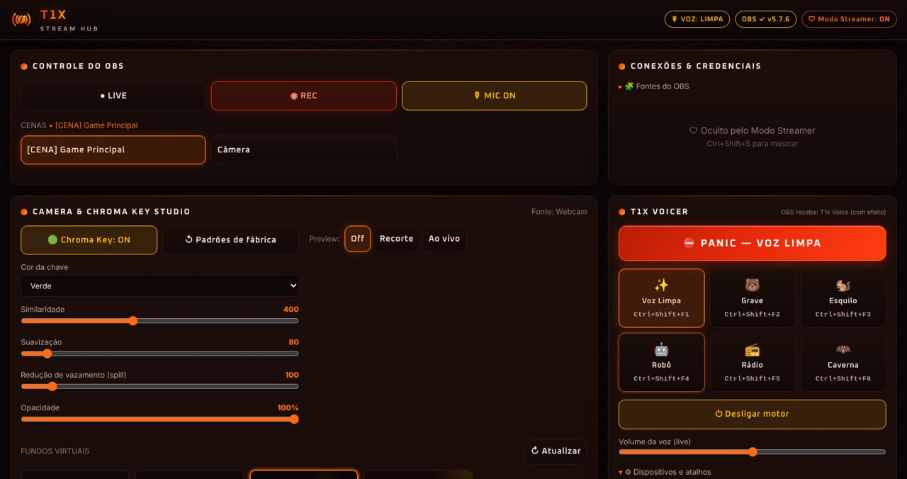

<p align="center"></p>

<h1 align="center">T1x Stream Hub</h1>

<p align="center">Painel de controle para lives: OBS, voz com efeito, câmera e chroma key, mixer de convidados e marcador de clipes — tudo numa janela só.</p>

<p align="center"><b>Windows x64 · Beta 0.5.0 · distribuição oficial</b></p>

## Baixar

[**Baixar a versão mais recente**](https://github.com/mathadoor23/t1x-stream-hub-releases/releases/latest)

Na página da versão, abra **Assets** e baixe **T1x-Stream-Hub-Setup-VERSAO.exe**. Esse é o instalador completo. Os arquivos `latest.yml`, `.blockmap` e `SHA256SUMS.txt` são usados pela atualização automática e para conferência; não é preciso abri-los.

Não precisa de Node, Java nem conta GitHub. O app instala no seu usuário do Windows (sem pedir administrador). Precisa do **OBS Studio 28 ou mais novo**, com o WebSocket ligado em *Ferramentas → Configurações do Servidor WebSocket*. Se o OBS estiver no mesmo PC, o Hub conecta sozinho.



## O que tem

| Módulo | O que faz |
|---|---|
| **Controle do OBS** | Cenas, live, gravação e mute do microfone com o estado real do OBS. |
| **T1x Voicer** | Voz com efeito em tempo real (Grave, Esquilo, Robô, Rádio, Caverna), botão **PANIC** e indicador fixo no topo. Se o app fechar ou travar, o OBS volta sozinho para o microfone direto. |
| **Camera & Chroma Key Studio** | Filtro de chroma (similaridade, suavização, spill, opacidade), fundos virtuais e prévia. O filtro nasce desligado. |
| **Mixer de Convidados** | Volume, corte e medidor de cada fonte de áudio do OBS; fixe convidados no topo. |
| **Instant Clip Marker** | Um clique ou atalho grava o momento em planilha, cria capítulo na gravação e salva o Replay Buffer. |
| **Modo Streamer** | Esconde senhas e chaves da tela. Começa ligado. |

**Atalhos globais** (funcionam com o jogo em foco, remapeáveis): `Ctrl+Shift+F1…F6` vozes · `F9` clipe · `F10` mic · `F12` PANIC.

Para a voz com efeito chegar ao OBS, instale o [VB-Audio Virtual Cable](https://vb-audio.com/Cable/) (grátis) e use **Fontes do OBS → Criar o que falta** no app.

## Atualizações

O app procura versões novas ao abrir e a cada 4 horas. O botão de versão no topo mostra um ponto dourado quando há novidade. Baixar e instalar são etapas separadas; **Instalar e reiniciar** pede confirmação e fecha o app.

**Beta 0.5.0:** primeira versão instalável. Visual nas cores Matt1x com símbolo e ícone próprios do Stream Hub. Atualização automática por este repositório. Conexão automática com o OBS do mesmo PC, assistente que cria as fontes que faltam, escolha automática do microfone real e da saída do cabo virtual. Os dados ficam em `%APPDATA%\T1x Stream Hub` e são preservados nas atualizações. Quem usava a cópia portátil: os dados são migrados na primeira abertura.

## Segurança ao baixar

- Use os downloads deste repositório oficial. Não use executáveis reenviados por terceiros.
- Ainda não há certificado Authenticode de editor: o Windows pode avisar "editor desconhecido". Hospedar no GitHub não certifica que um programa é seguro.
- Não desative antivírus ou SmartScreen. Se o Windows bloquear, pare e reporte.
- Cada versão inclui **SHA256SUMS.txt**. Para conferir o instalador no PowerShell:

```powershell
Get-FileHash -Algorithm SHA256 -LiteralPath '.\T1x-Stream-Hub-Setup-VERSAO.exe'
```

Compare com a linha correspondente do `SHA256SUMS.txt` da mesma versão. Hash igual confirma que o arquivo é o publicado; não comprova ausência de malware.

## Privacidade e suporte

Leia [Privacidade](PRIVACIDADE.md) e [Segurança](SEGURANCA.md). Problemas de uso vão nas [Issues](https://github.com/mathadoor23/t1x-stream-hub-releases/issues): informe versão, Windows, passos e mensagem de erro. Não inclua senhas, chaves de transmissão ou capturas com dados pessoais.

Esta é uma versão Beta, testada com o OBS 33 num PC real e com testes automatizados. Ainda faltam testes prolongados em outras máquinas e configurações.

Este repositório contém só documentação e arquivos de distribuição. O código-fonte não está publicado aqui.
